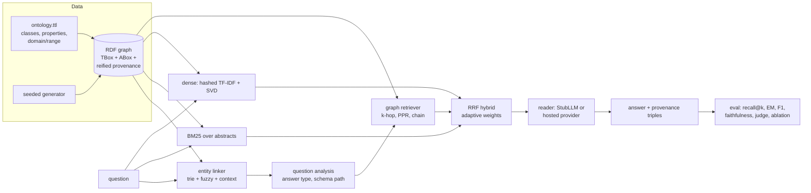

# kg-rag-lab

Neuro-symbolic retrieval lab: an RDF knowledge graph with an ontology, entity linking, and hybrid graph + vector retrieval for question answering, evaluated with an LLM-as-judge harness and ablations.


## What it demonstrates

- **Ontology plus generated instance data in RDF.** A small OWL/RDFS ontology in Turtle (Drug, Target as a subclass of Protein, Disease, Pathway, ClinicalTrial, Publication), a three-level disease hierarchy modelled with `rdfs:subClassOf`, `skos:altLabel` synonyms, and a seeded generator that produces 506 consistent entities, 590 facts and 150 short abstracts. Every abstract records which triples it states, as reified `rdf:Statement` nodes.
- **Lightweight reasoning where retrieval needs it.** Transitive `subClassOf` closure (checked against SPARQL `rdfs:subClassOf+`), type resolution through the hierarchy, synonym expansion, and schema-path search over `rdfs:domain` / `rdfs:range` to decide which chain of relations a question asks for.
- **Entity linking.** Longest match over a token trie built from labels and altLabels, case-sensitive matching for short abbreviations, a fuzzy fallback for typos, and disambiguation of colliding abbreviations using type cues and graph coherence with the other linked entities.
- **Four retrievers behind one interface,** all returning ranked facts with provenance: BM25 over abstracts, dense vectors (offline hashed TF-IDF + SVD, with a slot for a neural embedder), graph retrieval (k-hop expansion, query-aware relation weights, personalised PageRank, schema-path chains), and a hybrid that combines them with reciprocal rank fusion and query-adaptive weights.
- **Grounded answers.** A deterministic stub reader answers by walking the selected schema path *inside the retrieved facts only* and returns the provenance triples it used. An optional hosted LLM provider can be swapped in through the same `LLM` interface.
- **Evaluation and ablation.** 62 questions in five categories with gold answers computed by SPARQL; evidence recall@k, answer recall@k, exact match, fuzzy F1, faithfulness; an LLM-as-judge rubric with a deterministic `StubJudge`, plus a calibration table (agreement and Cohen's kappa against exact match, and a synonym probe).

## Architecture



The graph is the single source of truth: passages, facts, labels and provenance all come from it. Passage retrievers rank abstracts and then expand each abstract into the triples it states (from the reified statements), so every retriever is compared on the same unit, a fact, under the same budget of `k` facts. The graph retriever links entities, picks a schema path such as `^investigates / ^studiedIn / inhibits / participatesIn` for "Which pathway is targeted by drugs studied in trials for X?", walks that path on instance data, and ranks the resulting chain first, followed by the rest of the neighbourhood ordered by personalised PageRank. The hybrid reads the graph retriever's diagnostics (were entities linked, how long is the chain) to set the fusion weights for each question.

### Ablation (output of `kgrag eval`, k = 20 facts)

| retriever | evidence recall@20 | exact match | single-hop | two-hop | multi-hop | hierarchy | misspelled |
|---|---:|---:|---:|---:|---:|---:|---:|
| bm25 | 58.0 | 38.7 | 87.5 | 33.3 | 29.4 | 0.0 | 0.0 |
| dense | 58.2 | 41.9 | 87.5 | 26.7 | 35.3 | 0.0 | 40.0 |
| graph | 88.7 | 88.7 | 100.0 | 100.0 | 88.2 | 100.0 | 0.0 |
| hybrid-uniform | 86.8 | 79.0 | 100.0 | 100.0 | 70.6 | 44.4 | 40.0 |
| hybrid | 91.9 | 91.9 | 100.0 | 100.0 | 88.2 | 100.0 | 40.0 |

Category columns are exact match. Passage retrieval does well on single-hop questions, where one abstract holds the answer. It falls behind on multi-hop and hierarchy questions, where the evidence is spread over several abstracts that share no words with the question. The graph retriever fails completely when linking fails (the `misspelled` category), and there dense retrieval recovers part of the loss. The hybrid keeps both strengths. With uniform fusion weights it loses much of the multi-hop gain, because one-hop text matches outvote the deeper chain facts. The two remaining multi-hop errors are colliding disease abbreviations that the question gives no context to resolve.

**Judge calibration.** On questions with at most three gold answers, the stub judge's "fully correct" verdict agrees with exact match on 100% of the 250 system answers (kappa 1.00). When the same answers are rewritten with altLabel synonyms, exact match rejects all of them, while the judge accepts 181 of 250. A judge only earns trust on ambiguous cases after it agrees with the mechanical metric on unambiguous ones, and it must also be shown to differ from that metric where it should.

## Quickstart

Requires Python 3.12+. Dependencies (see `pyproject.toml`): rdflib, networkx, numpy, scipy, scikit-learn, rapidfuzz; pytest and ruff for development.

```bash
python3 -m venv .venv && source .venv/bin/activate
pip install -e ".[dev]"

kgrag build                      # writes build/kg.ttl and prints entity counts
kgrag ask "Which pathway is targeted by drugs studied in trials for Zonaeden sarcoma?"
kgrag ask "Which drugs were studied in trials for Hepatic fibrosis?" --retriever graph
kgrag ask "Which targets does LAB-1017 inhibit?" --retriever bm25
kgrag sparql "SELECT ?c WHERE { ?c rdfs:subClassOf+ kg:Disease }"
kgrag eval                       # ablation table as markdown

ruff check .
pytest
```

`kgrag ask` prints the linked entities, the selected schema path, the fusion weights, the retrieved facts with their source abstracts, any ontology facts it used, the answer, and the provenance triples. Optional extras: `pip install -e ".[llm]"` enables the hosted provider adapter (selected with `--llm auto` once its API key is set in the environment, see `src/kgrag/llm.py`). `pip install -e ".[embeddings]"` enables a neural sentence embedder for the dense retriever. Neither is needed by the tests.

## Design decisions

1. **Compare retrievers on facts, not passages.**
   *Decision:* every retriever returns ranked triples, and passage retrievers expand each abstract into the triples it states, using reified provenance.
   *Why:* recall@k over passages and recall@k over subgraphs measure different things, so a fair ablation needs one unit and one budget. Expanding passages through stored provenance acts as a perfect extractor, so the comparison isolates retrieval quality.
   *Trade-off:* it flatters the text retrievers (no extraction errors), so the real-world gap is likely wider than the table shows.

2. **Schema-path selection from ontology domain/range plus question cues.**
   *Decision:* enumerate relation paths between the linked entity's type and the expected answer type using `rdfs:domain` / `rdfs:range`, then score each path by how many of its relations are cued by words in the question.
   *Why:* for "pathways targeted by drugs studied in trials for X" the shortest path (Disease, Target, Pathway) is plausible but wrong. The cues pick the four-hop reading. Because this comes from the ontology, adding a relation needs no new question templates.
   *Trade-off:* cue lexicons are hand-written and English-only. Paraphrases with no cue word fall back to the shortest path.

3. **Rank chain facts path by path, ahead of PageRank.**
   *Decision:* facts on a complete seed-to-answer chain are ordered depth-first, one full path at a time, and placed before the rest of the PageRank-ranked neighbourhood.
   *Why:* PageRank mass decays with distance from the seed, so ranking on PageRank alone puts every first-hop fact above every last-hop fact. Under a small `k` the reader then sees many half-built chains and no answer. Ordering path by path means any prefix of the list holds complete chains.
   *Trade-off:* with hub-like seeds the chain alone can fill the budget, crowding out neighbourhood context that a free-form reader might have used.

4. **Reciprocal rank fusion with query-adaptive weights.**
   *Decision:* fuse rankings with RRF (scores ignored), and set per-question weights from the graph retriever's diagnostics: no linked entity means text only, a chain of three or more steps means text is down-weighted, otherwise votes are equal.
   *Why:* BM25 scores, cosines and PageRank mass are not comparable, and RRF avoids calibrating them against each other. Uniform RRF lets one-hop text matches outvote deep chains (70.6% vs 88.2% on multi-hop), and fixed weights cannot cover both the misspelled and the multi-hop cases.
   *Trade-off:* the weights are a hand-set rule. A learned router would need labelled data and would hide the reasoning that this rule keeps visible.

5. **Deterministic offline defaults everywhere.**
   *Decision:* hashed TF-IDF + truncated SVD embeddings, a template stub reader, a rubric stub judge, a seeded generator, and gold answers computed by SPARQL.
   *Why:* tests and CI must be reproducible with no model download or network access. Gold answers come from a code path independent of the retrievers (SPARQL property paths), so a bug in the graph code cannot also change the expected answers.
   *Trade-off:* LSA embeddings are much weaker than neural ones on paraphrase. The stub judge only shows how the harness behaves; it is not evidence about any model's grading quality.

6. **Fuzzy linking in two tiers.**
   *Decision:* a strict global fuzzy threshold against all surface forms, plus a relaxed match restricted to entities that appear in the retrieved context.
   *Why:* a low global threshold produces false links on ordinary capitalised words. Once retrieval has narrowed the candidates to a few dozen, a heavily misspelled name can be resolved safely, and that is how the dense retriever's recall becomes usable answers.
   *Trade-off:* the second tier depends on retrieval quality. If the right entity is not in the context, nothing recovers it.

## Scope and limits

- The data is synthetic and small (about 6.5k triples). The rdflib in-memory store and Python BFS are adequate at this size. Beyond a few million triples, use a persistent triple store and precomputed neighbourhoods.
- Questions come from templates. The cue lexicons and the answer-type parser cover these phrasings and close paraphrases, not open-domain language.
- Reasoning is limited to subclass closure and synonym expansion: no OWL DL reasoning, property chains or negation.
- The stub reader only answers list questions whose answers are entities. Yes/no, counting and temporal questions are out of scope.
- No reranker, query rewriting or iterative retrieval. Each would be a separate ablation axis.
- The hosted reader and judge adapters are not exercised in CI and need a network connection and an API key.

## About this lab

A compact reference implementation written in 2026. It reconstructs, on synthetic data, patterns I have used in production systems (ontology-driven entity linking, graph-augmented retrieval and grounded answer evaluation), without reproducing any proprietary design.

## License

MIT. See [LICENSE](LICENSE).
